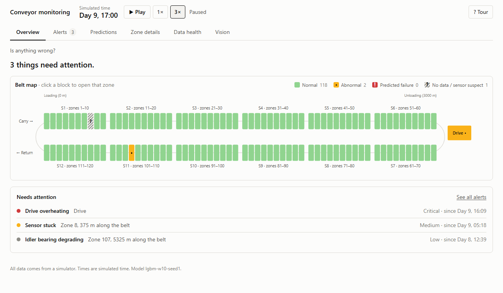
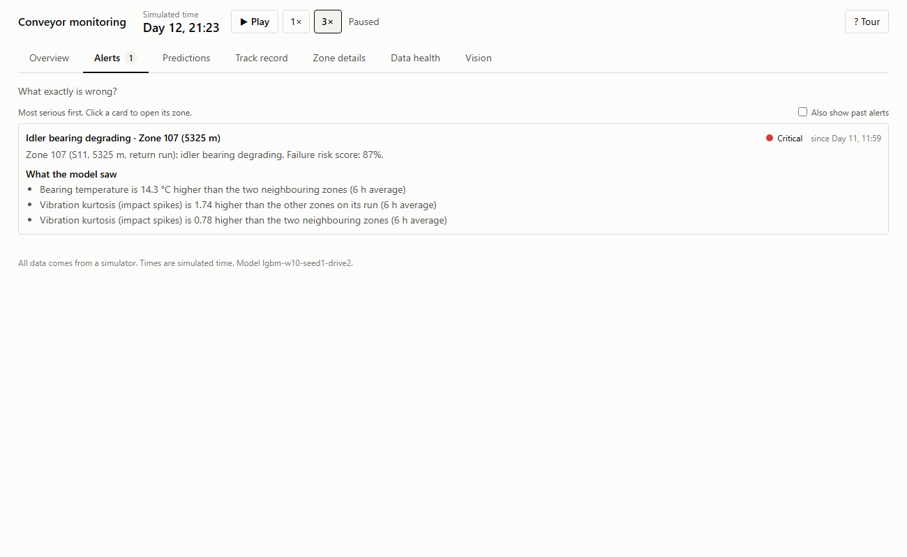
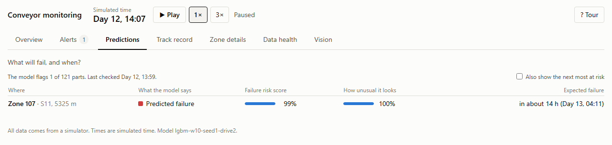
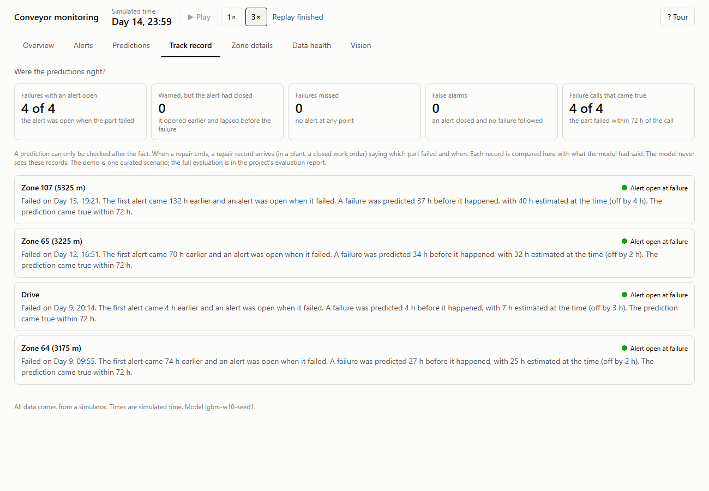
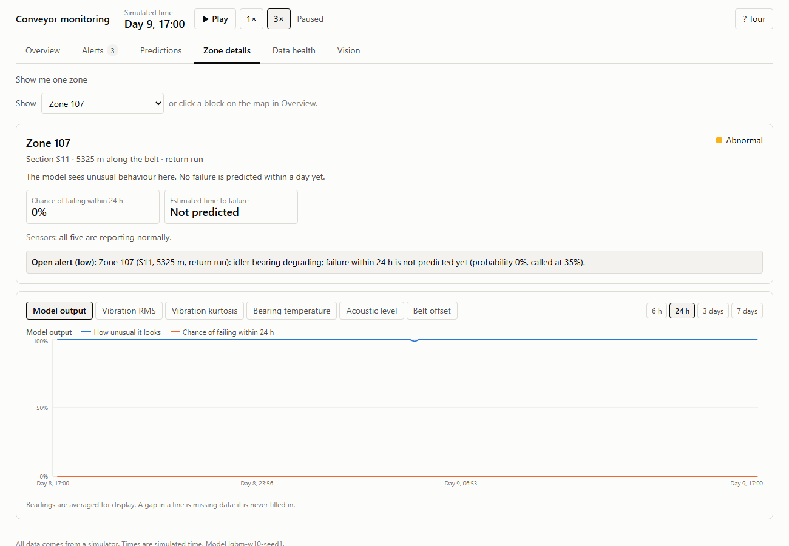
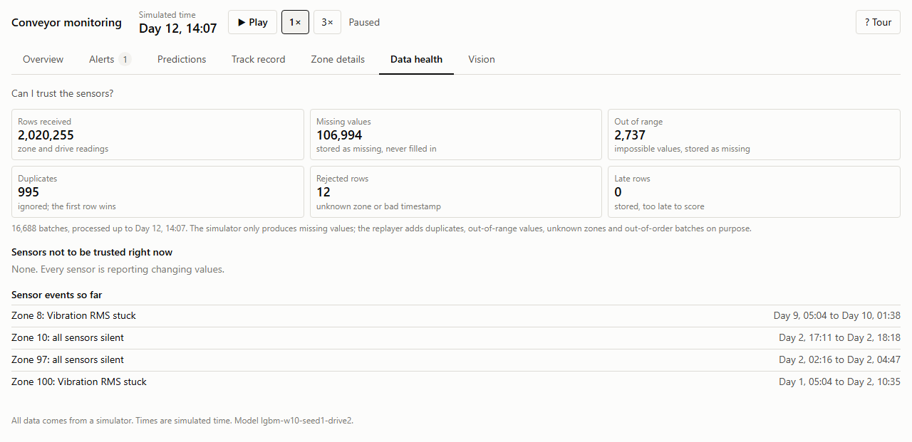
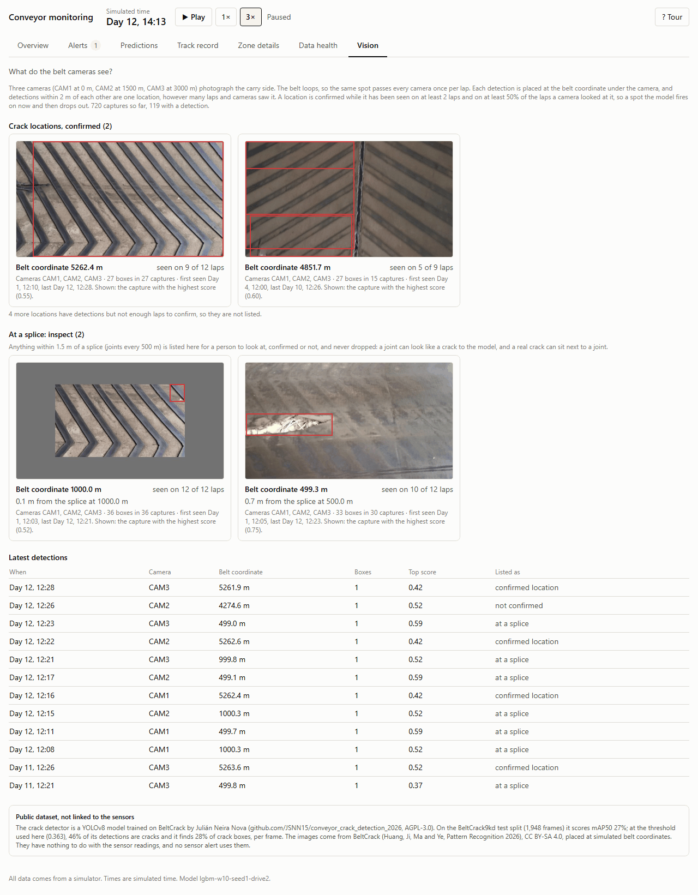

# Conveyor belt monitoring

This system watches a simulated 6 km mining conveyor loop. It reads five sensors in each of 120 zones along the
belt, plus the drive, and predicts idler-bearing and drive failures before they happen: what will fail, where, and
roughly when. A camera layer finds cracks in belt images and tracks each crack by its position on the belt, so a crack
that comes round every lap is reported once. The dashboard shows the status of every sensor point, active alerts,
model predictions, camera detections and how well the model has done so far.



## Quick start

You need Python 3.12 (or [uv](https://docs.astral.sh/uv/), which `make setup` uses to fetch 3.12). Node is not
needed: the built dashboard is committed.

```bash
make setup
```

```bash
make demo
```

Then open http://127.0.0.1:8000. `make demo` builds the 14-day demo scenario from its seed (a few seconds), starts
the backend and the replayer, posts the first simulated day at full speed (about 10 s), then replays the other
13 days at 1 simulated hour per second, so about 5.5 minutes. You can pause or switch to 3x in the top bar. Ctrl-C
stops it.

```bash
make test
```

Without `make`, run `python -m simulator.scenario_set --only demo_01` and then `python -m scripts.demo` inside the
virtual environment. Other targets (`data`, `features`, `train`, `score`, `frontend`, `dev`, `lint`) are listed
in the `Makefile`.

## Design decisions

The design and build plan is [docs/BUILD_PLAN.md](docs/BUILD_PLAN.md). The simulator spec is
[SIMULATOR_SPEC.md](SIMULATOR_SPEC.md), and the vision write-up is [docs/VISION_REPORT.md](docs/VISION_REPORT.md).

**What I monitor.**
- **The belt:** a 6 km loop (3 km carry side, 3 km return) at 4 m/s, so one lap takes 25 minutes. It runs 18 hours a
  day.
- **Sensor points:** one sensor suite every 50 m, giving 120 zones in 12 sections of 500 m. Each suite reports
  vibration RMS, vibration kurtosis, bearing temperature, acoustic level and belt offset every minute. Real
  installations space sensors from about 1 m to 25 m; one suite per 50 m zone is coarser, but it is enough to say
  which zone is failing, and it keeps the data small enough for a laptop.
- **The drive:** throughput, motor current, motor and gearbox temperature, drive and belt speed, slip and tension.
- **Cameras:** three, on the carry side at 0 m (loading), 1500 m and 3000 m (unloading), because most wear happens
  where material is loaded and unloaded.

**The simulator** (`simulator/`) is mine, as the brief requires.
- **Faults:** two kinds, idler bearings wearing out and the drive overheating.
- **Harmless look-alikes:** heavy load, heat waves, dusty spells and start-ups. They are labelled as not faults, so the
  model has to learn the difference.
- **Messy data:** missing readings, whole-suite outages, stuck sensors, and per-scenario noise, drift and shared noise.
- **Separation:** everything is seeded. Ground truth goes in a `truth/` folder that the live path never reads, and a
  test scans the code to enforce that.

**The prediction model** is LightGBM, chosen because it trains in minutes on two CPU cores, copes with rare events
and is easy to explain. There is one zone model for all 120 zones and a separate drive model, because the drive has
different signals and far fewer events.

**The backend** is FastAPI with SQLite. SQLite is enough for one belt. The database is rebuilt on every start, so
each demo run is fresh.

**The dashboard** is React with TypeScript, served by the backend. It has one tab per question: is anything wrong,
what exactly, what will fail and when, were the predictions right, one zone in detail, can I trust the sensors, and
what the cameras see.

## How it works

**Data flow.**
1. The simulator writes each scenario's public tables to `data/<scenario>/public/`.
2. The replayer, a separate process, posts one batch per simulated minute to `POST /api/ingest`, and camera captures
   to `POST /api/captures`.
3. The backend validates and stores the readings, tracks sensor health, and every 10 simulated minutes builds
   features and scores all 121 assets (120 zones and the drive).
4. The dashboard polls the API.

Training and live scoring use the same feature code (`model/features.py`), so the two cannot drift apart.

**Messy input.** The simulator produces missing readings, outages, stuck sensors, noise and drift. The replayer adds
the rest on purpose (duplicates, out-of-range values, unknown zones and swapped batches), so the validation really
runs. Rates are in
`configs/app.yaml`. What the code does:
- A row with an unknown zone or a bad timestamp is rejected and counted. For a duplicate, the first row wins.
- A value outside its physical range is stored as missing and counted. Missing values are never filled in.
- Late batches are put back in order using a watermark with 2 minutes of grace.
- A signal repeating the same value 15 times while the belt runs is marked stuck. A suite with all five signals
  missing for 5 minutes is marked no data.
- A stuck or silent sensor turns its zone grey ("no data / sensor suspect"), never green. Only a predicted failure
  outranks it.
- In the features, stuck readings are dropped. Each zone is compared with the median of the other zones on its run,
  which removes shared effects like a heat wave or heavy load.

The Data health tab counts all of this live.

**The model.** Readings are grouped into 10-minute windows. Features are rolling 1 h, 6 h and 24 h statistics:
deviation from other zones, rise against the zone's own past, and the difference from neighbouring zones. That gives
72 zone features and 34 drive features (`model/artifacts/meta.json`). Each asset group has three models:
- "abnormal", trained on the advanced stage of a fault against normal;
- "fails within 24 h";
- hours to failure.

Alerts open after 2 windows above the threshold and close after 6 below (`model/alerting.py`). Each alert stores its
top three feature contributions, shown as "What the model saw". Thresholds were tuned on validation scenarios for an
alert precision of at least 90%, then frozen (zone: 0.997 for an alert and 0.990 for a failure call).

**Evaluation.** Every split is by whole scenario: 8 training scenarios (plus 6 drive-only ones), 6 validation, 2
test and 1 stress scenario. After the old test scenarios had been used for diagnosis, I froze the models and scored
4 fresh scenarios (seeds 501 to 504) once, with criteria written down beforehand. The table below is that result
(`model/artifacts/fresh_test_report.md`):

| Asset | Faults | Caught by an alert | False alerts | Failure calls that came true within 72 h | Median hours from call to failure |
|---|---|---|---|---|---|
| Idler bearings | 20 | 16 (80%) | 0 | 10 of 10 | 14.2 |
| Drive | 12 | 6 (50%) | 0 | 6 of 6 | 5.6 |

On the old test scenarios the model caught 8 of 10 bearing faults, against 4 for a fixed temperature limit and 5 for a
neighbour-deviation check, with 0 false alerts for all three (`model/artifacts/eval_report.md`).
`model/artifacts/robustness_report.md` shows where it breaks: with sensor drift at the top of the training range it
catches only 3 of 8 bearing faults.

## Vision component

**Dataset.** BeltCrack9kd (Huang, Ji, Ma and Ye, *Pattern Recognition* 2026, doi:10.57760/sciencedb.31181,
CC BY-SA 4.0). I chose it because:
- the images are real industrial belts rather than lab samples;
- they are sequential frames from a moving belt, which suits a belt that passes the same camera again and again;
- the test split is 9 whole sequences held out from training, so a test score is not inflated by near-identical
  frames.

The official split:

| Split | Sequences | Images | Boxes |
|---|---|---|---|
| Train | 23 | 5,736 | 7,790 |
| Val | 10 | 1,961 | 2,615 |
| Test | 9 | 1,948 | 2,482 |

**The detector.** I tried to train my own. I first set up a replication of the paper's model, BeltCrackDet, and then a
smaller single-frame YOLO11s, both on BeltCrack9kd. Neither finished. My PC did not have the compute: it became
unusable under the load and I lost time to it. I then tried twice on a Colab T4 GPU, and both runs stopped when the
compute credits ran out, on two different accounts. The BeltCrackDet replication alone needed about 74 GPU-hours.

So the detector I ship is a pretrained YOLOv8 crack model trained on BeltCrack by Julián Neira Nova
(github.com/JSNN15/conveyor_crack_detection_2026, AGPL-3.0). I did not train it. What I did:
- ran it with onnxruntime on CPU, with the author's preprocessing (`vision/detector.py`);
- chose its threshold on the val split (0.363);
- scored the test split once (`vision/artifacts/vision_eval.json`).

| Test split, 1,948 frames | mAP50 | mAP50-95 | Precision at 0.363 | Recall at 0.363 |
|---|---|---|---|---|
| Pretrained YOLOv8 | 26.9% | 13.7% | 45.9% | 28.2% |

That mAP50 is close to the paper's single-frame and 5-frame models on the same split (24.8% and 27.0%). One caveat:
the author does not say which frames the model was trained on. Val scores 73.3% mAP50, so val was probably in its
training data, and the threshold chosen there is optimistic.

**The looping belt.** These are the problems I identified, and how I handle each:

| Problem | What I do |
|---|---|
| The same crack comes back every lap (every 25 minutes) | Each detection is placed at the belt coordinate under the camera, (station − belt travel) mod 6000. Detections within 2 m are one location, and locations that drift within 2 m are merged. |
| Three cameras see the same spot on one lap | Captures of one location less than 1125 s apart count as one lap, so three cameras do not count as three laps. |
| Encoder and stretch error in the belt coordinate | I add 0.5 m of random error to every capture's coordinate; the 2 m merge radius absorbs it. |
| Splices can look like damage | Joints sit every 500 m. Anything within 1.5 m of one goes to a separate "at a splice, inspect" list, confirmed or not, and is never dropped. |
| Single-frame false hits (the detector's precision is 46%) | A location is confirmed only while it has been seen on at least 2 laps and on at least 50% of the laps a camera looked at it. |

I chose K = 2 and R = 50% on a separate simulator run (seed 2027), not on the demo, with the selection rule fixed in
code first (`scripts/tune_dedup.py`, `vision/artifacts/dedup_tuning.json`). The demo has 14 recorded laps and 840
captures. The table below shows both rules (`vision/artifacts/dedup_eval.json`):

| | Old rule: seen on 2 laps | Rule in use |
|---|---|---|
| Crack locations found | 3 of 4 | 3 of 4 |
| Duplicates | 0 | 0 |
| Crack 0.7 m from a splice | found, in the inspect list | found, in the inspect list |
| Laps to confirm | 2, 3, 5 | 2, 3, 5 |
| False confirmed defects at the end | 4 | 0 |
| False entries in the inspect list | 1 | 1 |

The missed crack is on a chevron-pattern belt (sequence `data39`), where the model never fires. The false inspect
entry is the splice at 1000 m, which fires on every lap; that is what the inspect list is for. Under the new rule,
one false location is confirmed for a while early on, before its ratio drops. I picked the demo's images by eye: two
side-view sequences (`data34`, `data38`) are left out, and clean images come only from sequences that show belt
surface.

**What I chose not to solve:**
- **Drifting position error.** A real encoder drifts and a belt stretches, so position error grows between
  reference points. I only add independent noise; a real system would re-anchor on each splice.
- **Crack growth.** I do not track whether a crack grows. Frames have no metric scale, so I cannot map a box to
  centimetres.
- **Linking cameras and sensors.** The images are a public dataset placed on a simulated belt; linking them to the
  sensors would only show agreement I had wired in myself.
- **Return-side cameras.**
- **Every lap.** Cameras record one full lap per running day, not every lap. Recording every lap would need thousands
  of dataset frames in the repo; this way the demo uses 72 images (2.5 MB).

## Dashboard

The dashboard is one page with seven tabs, one per question. The top bar shows the simulated time and has Play/Pause
and 1×/3× speed buttons. "Tour" opens a one-minute guided walkthrough, which also opens on the first visit. The
screenshots are from `make demo`, paused on day 12 (Overview and Vision at 14:13 after the demo images were changed,
the others at 14:07), except the track record, which is from the end of the replay.

### Overview: is anything wrong?


**The belt map.** The map shows all 120 sensor points as a loop. The carry side is on top (zones 1 to 60, loading on
the left), the return side is below, and the drive sits on the right. Each block has one of four statuses:
- green, normal;
- amber with a dot, the model sees unusual behaviour;
- red with "!", a failure is predicted within 72 hours;
- grey stripes with "?", the sensors are silent or stuck, so the status is unknown.

Here Zone 107 is flagged by the model. Clicking any block opens that zone.

**Below the map:**
- the model's accuracy so far in this run, plus the fresh-test result;
- the camera counts;
- a short "needs attention" list.

### Alerts: what exactly is wrong?



One card per problem, most serious first: what is wrong, where, how serious, and when the part is expected to fail.
Each model alert lists what the model saw, in plain sentences, so an engineer can judge it. "Critical" is used only
when a failure is predicted within 72 hours.

### Predictions: what will fail, and when?



The parts the model flags right now, with their failure risk score, how unusual they look, and the expected failure
time. A tick box also shows the next most at-risk parts.

### Track record: were the predictions right?



When a repair ends, a repair record arrives saying what failed and when. This tab sets each record against what the
model had said: warned in time, missed, or a false alarm. The model never sees these records. This is the end of the
demo: 4 of 4 failures had an alert open, with no false alarms.

### Zone details: show me one zone



Everything about one zone or the drive: its status, failure risk, estimated time to failure, the state of its five
sensors and any open alert. The chart plots the model output or one sensor at a time, over 6 hours to 7 days. Gaps in
a line are missing data; they are never filled in.

### Data health: can I trust the sensors?



What went wrong on the way in, counted live: missing values, impossible values, duplicates, rejected rows and late
rows. Below are the sensors that are silent or stuck right now, and every sensor event so far.

### Vision: what do the belt cameras see?



**Confirmed crack locations.** One card per place on the belt. Each card shows the best capture with the detector's
boxes, the belt coordinate, the cameras that saw it, and "seen on X of Y laps".

**At a splice: inspect.** Anything near a splice joint is listed separately for a person to check. The entry at
1000 m here is a splice the model fires on every lap.

**Below:** the latest detections, and a strip with the detector's test numbers, marked "public dataset, not linked to
the sensors".

## Assumptions

Where the brief was open, I chose these. The numbers live in `configs/` so they can be changed:
- **Belt:** the size, speed and duty cycle described above, and readings every minute.
- **Faults:** amplitudes and growth shapes are my assumptions, informed by a few papers. Early bearing faults are
  faint by design, so the model targets the advanced stage. Failure calls come a median 14 hours before the bearing
  fails (fresh test).
- **Alerts:** at most 1 or 2 false alerts in 20 (precision at least 90%). This is my bar for an alert list people
  would trust.
- **Stuck sensors:** detected by exact repeats. That assumes noisy floating-point readings; a coarse real sensor would
  need another rule.
- **Splices:** 500 m apart at known belt coordinates.
- **Cameras:** carry side only, one recorded lap per running day.
- **The demo scenario is curated:** seed 1015 is the first seed in 1000 to 3000 that passes rules set in advance (a
  full bearing fault, one drive fault, a heat wave, a stuck sensor and an outage). The test scenarios are not curated.

## Limitations and what I would do differently

- **Simulated data.** The model learns my simulator's rules, so its scores do not show it works on a real belt. The
  first thing I would do with a client is replay their historical sensor data and failure records through the same
  pipeline.
- **The drive model is weak evidence.** It caught 6 of 12 drive faults in the fresh test, and there are few drive
  events to learn from.
- **Sensor drift hurts.** At the top of the training range, the bearing model catches only 3 of 8 faults. I would add
  drift correction against neighbouring zones over longer windows.
- **Chevron belts.** The detector misses cracks on them: the demo's `data39` crack got no detection in 42 captures.
  The model's author notes that chevron-pattern belts were "almost absent from training".
- **I did not train my own detector.** With more time and compute, I would train one on the client's own belt video,
  with their belt types, lighting and splices. A public model on a public dataset finds 28% of crack boxes per frame
  here.
- **The confirmation rule rests on one tuning run** with two detectable cracks, and its margin is thin. The weakest
  real crack was seen on 54% of its laps, the worst false location on 46%. I would retune R on more runs, or on real
  inspection records.
- **Persistent false hits** (like the splice at 1000 m) pass any lap-based rule. Only a person, or a model trained on
  the client's splices, can clear them.

## Repo layout

```
backend/     FastAPI app, ingest and validation, live scoring, vision service, SQLite schema
common/      asset ids shared by every part
configs/     simulator defaults, one YAML per scenario, app settings
data/        generated scenarios (git-ignored); vision_demo/ holds the 72 committed demo images
docs/        build plan, reports, changelog, screenshots
frontend/    React dashboard; dist/ is the committed build
model/       features, training, alerting, evaluation; artifacts/ holds the frozen models and reports
replayer/    replays a scenario into the backend over HTTP
scripts/     demo runner, model data, scoring, robustness, vision scoring and tuning
simulator/   the sensor and camera simulator
tests/       pytest suite, including a leakage guard
tools/       plotting scripts for the simulator stages
vision/      detector wrapper, de-duplication rules, evaluation, dataset preparation, model artifacts
```

## AI usage

I used Claude.ai for research, the dataset and model search, and plan reviews. I used Claude Code to build: planning
each stage, writing the code, tests and reports, and checking the results. I set the scope, made the design calls,
corrected the plans when they were wrong, and reviewed what came back before committing it. The decisions and how
they paid off are in [ai_usage/how_i_used_ai.md](ai_usage/how_i_used_ai.md); the chat links and logs are listed in
[ai_usage/links.md](ai_usage/links.md).

## Credits and licences

- **Dataset:** BeltCrack, by Huang, Ji, Ma and Ye, *Pattern Recognition* 2026 (doi:10.1016/j.patcog.2026.113598;
  data: doi:10.57760/sciencedb.31181), CC BY-SA 4.0. The demo images in `data/vision_demo/` are reduced and cropped
  from its test split and shared under the same licence (see `data/vision_demo/ATTRIBUTION.md`).
- **Detector:** a YOLOv8 crack model by Julián Neira Nova (github.com/JSNN15/conveyor_crack_detection_2026), used
  unchanged under the GNU AGPL-3.0. The notice is in [vision/artifacts/NOTICE.md](vision/artifacts/NOTICE.md) and the
  licence text in `vision/artifacts/LICENSE-AGPL-3.0.txt`. Anyone who distributes the model, or offers it to users over
  a network, must do so under the AGPL-3.0.
- **Ultralytics:** the model was trained with Ultralytics YOLOv8, also AGPL-3.0. This repo runs the exported ONNX file
  with onnxruntime and does not include Ultralytics.
